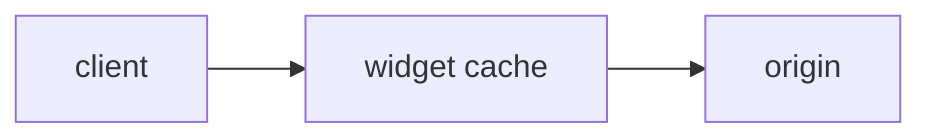

# Plan: widget

Intro prose that is not a node.

## O1: widgets are fast

Latency is the product.



## O2: widgets are safe

Unsigned payloads are rejected.

## R1: cache goes stale

severity: high

Mitigation: TTL plus explicit invalidation.

## R2: origin overload

severity: low

Mitigation: request coalescing.

## D1: benchmark exists

## D2: safety audit passes

```text
## S99: this heading is inside a fence and must not be a node
```
